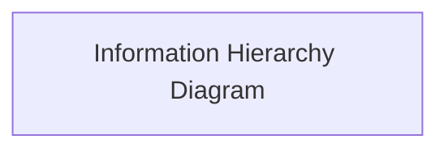
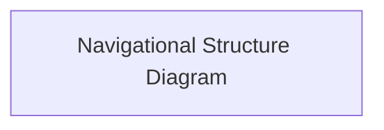
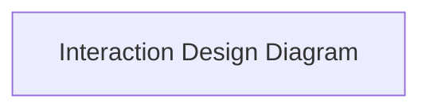
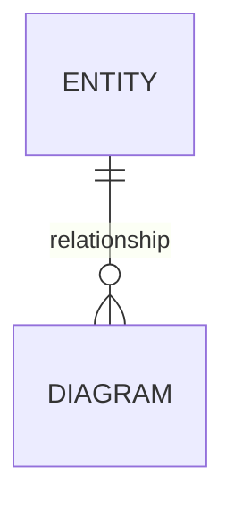

# Stash

# To Do App

Project overview/introduction.

[View the live site here.](live-link)

## Agile Delivery

## UX

### Strategy

#### Purpose

#### User Needs

#### Business Requirements

### Scope

#### Mapping User Needs to Features

#### Defining MVP

### Structure

#### Information Architecture

#### Navigation Design

#### Interaction Design

### Skeleton

#### Wireframing

| Page | Mobile | Tablet | Desktop |
| --- | --- | --- | --- |

### Surface

Summary of the design philosophy and aims.

#### Colour

#### Typography

#### Shape & Space

#### Animation & Micro-Interactions

## Architecture

### Database & Model Design

#### Entity Relationships

#### Model Design

#### Role-Based Permissions

| Role | Permissions | Related Django Flag |
| --- | --- | --- |

### Modularity & Data Boundaries

### Security & Authentication

#### Environmental Configuration

#### Global Login Controls

#### CSRF/XSS Safeguards

### Frontend Engineering

#### Efficiency

#### Safety

## Features

| Feature | Appearance | User Value |
| --- | --- | --- |

### Future Features

## Quality Assurance

### CI/CD

### Test Coverage

### Code Validation

### Responsiveness & Compatibility

| Page | Firefox - Mobile | Chrome - Tablet | Edge - Laptop | Safari - Desktop |
| --- | --- | --- | --- | --- |

### Lighthouse Reports

#### Mobile

#### Desktop

### Known Bugs

## Tools & Stack

### Tech Stack

### Development Tooling

### Design Tools

### AI

## Deployment

### Heroku

### Local Development

## Credits
