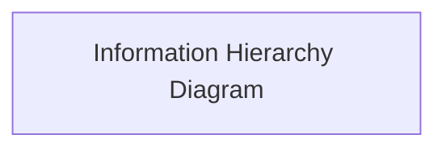
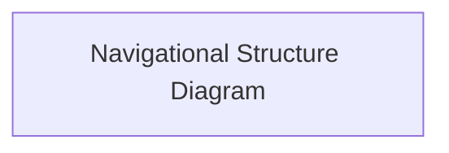
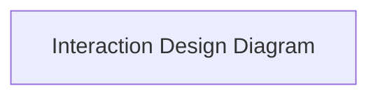
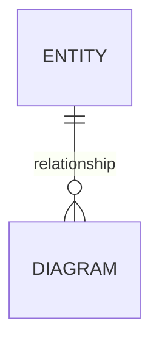

# Stash

_**Oh - what's that command again?**_

For all those code snippets, commands, and technical notes you use just infrequently enough to forget, only to find yourself grumpily trawling through the same docs page. Again.

Stash is a personal developer reference app for the things you can't believe you still haven't managed to remember *(but know you probably won't)*. Save them once, find them when you need them.

[View the live site here.](live-link)


## Agile Delivery

### Agile Approach

### Scope & Prioritisation

### Backlog Management

### Development Workflow

### Continuous Quality Assurance

## UX

### Strategy

#### Purpose

#### User Needs

#### Business Requirements

### Scope

#### Mapping User Needs to Features

#### Defining MVP

### Structure

#### Information Architecture



#### Navigation Design



#### Interaction Design



### Skeleton

#### Wireframing

| Page | Mobile | Tablet | Desktop |
| --- | --- | --- | --- |

### Surface

Summary of the design philosophy and aims.

#### Colour

#### Typography

#### Shape & Space

#### Animation & Micro-Interactions

## Architecture

### Database & Model Design

#### Entity Relationships



#### Model Design

#### Role-Based Permissions

| Role | Permissions | Related Django Flag |
| --- | --- | --- |

### Application Structure & Data Boundaries

### Security & Authentication

### Server-Rendered Frontend & HTMX

## Features

| Feature | Appearance | User Value |
| --- | --- | --- |

### Future Features

## Quality Assurance

For readability, the detailed quality assurance documentation is maintained in [QA.md](documentation/QA.md), which can be found in the 'documentation' directory.

## Tools & Stack

### Tech Stack

| Technology | Purpose |
| --- | --- |
| [Python](https://www.python.org/) | Core programming language. |
| [Django](https://www.djangoproject.com/) | Full-stack web framework. |
| [HTML](https://developer.mozilla.org/en-US/docs/Web/HTML) | Page structure and semantic markup. |
| [CSS](https://developer.mozilla.org/en-US/docs/Web/CSS) | Styling and layout. |
| [Django Template Language](https://docs.djangoproject.com/en/6.1/ref/templates/language/) | Dynamic server-rendered HTML using Django templates. |
| [Bootstrap](https://getbootstrap.com/) | Responsive UI styling and components. |
| [HTMX](https://htmx.org/) | Dynamic page updates without a full JavaScript framework. |
| [PostgreSQL](https://www.postgresql.org/) | Relational database. |

| [django-allauth](https://docs.allauth.org/) | User authentication and account management. |
| [WhiteNoise](https://whitenoise.readthedocs.io/) | Static file serving in production. |
| [Neon](https://neon.com/) | Hosted PostgreSQL database. |
| [Render](https://render.com/) | Application hosting and deployment. |

### Development Tooling

| Tool | Purpose |
| --- | --- |
| [uv](https://docs.astral.sh/uv/) | Manage Python versions, virtual environments, and project dependencies. |
| [Ruff](https://docs.astral.sh/ruff/) | Lint and format Python code. |
| [mypy](https://mypy.readthedocs.io/en/stable/) and [Django stubs](https://github.com/typeddjango/django-stubs) | Provide static type checking and Django-specific type information. |
| [djLint](https://www.djlint.com/) | Lint and format Django templates. |
| [pre-commit](https://pre-commit.com/) | Run automated checks before commits. |
| [pytest](https://docs.pytest.org/) | Run unit and integration tests. |
| [Factory Boy](https://factoryboy.readthedocs.io/) | Generate test data using reusable model factories. |
| [Coverage.py](https://coverage.readthedocs.io/) | Measure test coverage. |
| [Git](https://git-scm.com/) | Version control. |
| [lazygit](https://github.com/jesseduffield/lazygit) | Provide a terminal interface for managing Git changes, branches, and commit history. |
| [GitHub](https://github.com/) | Repository hosting and issue management. |
| [GitHub Actions](https://github.com/features/actions) | Automate continuous integration checks. |


### AI

## Deployment

[View the deployed site on Render.](link)

### PostgreSQL Database

This project uses [Neon](https://neon.tech/) to host its PostgreSQL relational database.

To create a PostgreSQL database using Neon, follow these steps:

1. Create an account on [Neon](https://neon.tech/).
2. From your Neon Dashboard, select 'New project'.
3. Configure the project name and select the region closest to you.
4. Under Services, enable the Postgres database service and leave the other service toggles disabled.
5. Click 'Create project'; you will then be shown the database connection details.
6. Copy the provided PostgreSQL connection string, which will follow a format similar to:

    ```text
    postgresql://<db_username>:<db_password>@<db_host>/<db_name>?sslmode=require
    ```

The connection string contains the credentials and connection details Django needs to connect to the database. The actual values are specific to your database.

> [!WARNING] 
> Never commit database credentials to GitHub.

Set the connection string as `DATABASE_URL` in your `.env` file for local development; or in the Render Dashboard for production.

For further information, see Neon's [connection details documentation](https://neon.tech/docs/connect/connect-from-any-app).

### Render Deployment

This project is deployed using [Render](https://www.render.com), a cloud-hosting platform-as-a-service (PaaS).

#### Configuring Deployment

[`render.yaml`](render.yaml) defines the Render web service and its environment variables, including the commands used to build and start the application. A `render.yaml` file defines a Render Blueprint, which allows the web service and its configuration to be managed as code. See the [Render Blueprints documentation](https://render.com/docs/blueprints) for further information.

The build command, `./build.sh`, tells Render to execute the project's [build script](build.sh) during deployment. This script installs production dependencies, collects static files, and applies database migrations.

Ensure the script has executable permissions before committing it to the repository:

```bash
chmod a+x build.sh
```

The start command specifies how Render launches the application. This project uses Gunicorn as its WSGI application server:

```bash
python -m gunicorn config.wsgi:application
```

Both commands are defined in [`render.yaml`](render.yaml), so they do not need to be entered separately when deploying through a Blueprint.

#### Environment Variables

The application requires the following environment variables in production.

| Key | Value | Configuration |
| --- | --- | --- |
| `DJANGO_SETTINGS_MODULE` | config.settings.production | Defined in `render.yaml` |
| `SECRET_KEY` | A securely generated Django secret key | Generated by Render during initial service creation |
| `DATABASE_URL` | Your Neon PostgreSQL connection string | Supplied during initial Blueprint creation |
| `ALLOWED_HOSTS` | Your Render hostname, e.g. your-app.onrender.com | Supplied during initial Blueprint creation |
| `CSRF_TRUSTED_ORIGINS` | Your site's HTTPS origin, e.g. https://your-app.onrender.com | Supplied during initial Blueprint creation |

> [!WARNING]
> Never commit secret credentials, database connection strings, or other sensitive environment variable values to GitHub. Configure production secrets securely through Render.

#### Initial Deployment

Before beginning these steps, ensure your project is pushed to a GitHub repository, and that [`render.yaml`](render.yaml), [`build.sh`](build.sh), [`pyproject.toml`](pyproject.toml), and [`uv.lock`](uv.lock) are committed.

1. Create an account on [Render](https://www.render.com).
2. In the Render Dashboard, navigate to **Blueprints** and select **New Blueprint Instance**.
3. Connect your GitHub account and select the repository containing `render.yaml`.
4. Provide a name for the service and select the branch you want to deploy. In most cases, this will be `main`.
5. Provide the requested environment variable values (see [Environment Variables](#environment-variables) for details), then create the Blueprint instance. This will trigger a build deployment.
6. Wait for the build and deployment to complete, then open the service's public URL to verify that the application is running.

Following this initial deployment, Render deployments are automatic by default, so any code which is pushed to your selected branch will trigger a new deployment.

For further details, see Render's [Django deployment guide](https://render.com/docs/deploy-django) and [Blueprint documentation](https://render.com/docs/infrastructure-as-code).

### Static Files

This project uses [WhiteNoise](https://whitenoise.readthedocs.io/en/stable/) to serve static files in production, including CSS, JavaScript, and other assets. WhiteNoise allows Django to serve these files directly without requiring a separate static-file hosting service.

During deployment, the `collectstatic` command collects static files from the project and its installed applications into the directory specified by `STATIC_ROOT`. WhiteNoise serves the collected files using compressed, manifest-based storage to improve delivery efficiency and ensure static file references remain consistent.

WhiteNoise supports both Gzip and Brotli compression. Brotli is an alternative compression format that can produce smaller files, reducing the amount of data transferred to the browser. Render describes Brotli support as optional but recommended for improved static asset delivery.

#### Configuring WhiteNoise

To configure WhiteNoise in your own Django project:

1. Install WhiteNoise using `uv`:

    ```bash
    uv add "whitenoise[brotli]"
    # Or, to add without support for Brotli compression:
    uv add whitenoise
    ```

2. Add WhiteNoise to `MIDDLEWARE` in your Django settings, immediately after `django.middleware.security.SecurityMiddleware`:

    ```python
    MIDDLEWARE = [
        "django.middleware.security.SecurityMiddleware",
        "whitenoise.middleware.WhiteNoiseMiddleware",
        # Remaining middleware
    ]
    ```

3. Configure static file storage in your Django settings:

    ```python
    STORAGES = {
        "default": {
            "BACKEND": "django.core.files.storage.FileSystemStorage",
        },
        "staticfiles": {
            "BACKEND": ("whitenoise.storage.CompressedManifestStaticFilesStorage"),
        },
    }
    ```
This enables manifest-based static file storage with compression. Brotli and Gzip compressed versions can be served when supported by the client's browser.

4. Ensure `STATIC_ROOT` is configured so Django knows where to collect static files:

    ```python
    STATIC_ROOT = BASE_DIR / "staticfiles"
    ```

5. Run the following command to collect static files before serving the application in production:

    ```bash
    python manage.py collectstatic --noinput
    ```

For further information, see the [WhiteNoise Django documentation](https://whitenoise.readthedocs.io/en/stable/django.html) and [Render's Django deployment guide](https://render.com/docs/deploy-django).

### Local Development

To run this project on your local machine, follow these steps.

#### Forking & Cloning the Repository

1. Navigate to the [Stash GitHub repository](https://github.com/mol-thompson/stash).
2. Select **Fork** in the top-right corner to create a copy of the repository under your own GitHub account.
3. On your forked repository, select **Code** and copy the HTTPS URL.
4. Open a terminal and navigate to the directory where you want to store the project.
5. Clone your forked repository:

    ```bash
    git clone <your-forked-repository-url>
    ```

6. Navigate into the project directory:

    ```bash
    cd stash
    ```

#### Prerequisites

Before proceeding, ensure you have the following installed:

- [uv](https://docs.astral.sh/uv/getting-started/installation/) — for Python version, virtual environment, and dependency management. If you already have Python installed, you can install `uv` using pip:

```bash
python -m pip install uv
```

  Alternatively, follow the [official installation instructions](https://docs.astral.sh/uv/getting-started/installation/) to install `uv` directly. This allows `uv` to download and manage the Python version specified in `.python-version` if it is not already installed. For this project, that is `3.13.x`.
- [Git](https://git-scm.com/downloads) — for version control.
- A PostgreSQL database accessible from your local machine. The steps outlined in [PostgreSQL Database](#postgresql-database) can be used to create a database for this purpose. 

> [!NOTE]
> Use a separate database for local development rather than your production database. This prevents local development and testing from accidentally modifying production data.

#### Installing Dependencies

This project uses Astral's `uv` to manage Python dependencies. From the project root, run:

```bash
uv sync
```

This downloads the Python version specified in [.python-version](.python-version) if it is not already installed, creates a virtual environment in .venv, and installs the project dependencies defined in [pyproject.toml](pyproject.toml) according to [uv.lock](uv.lock).

#### Environment Variables

Create a `.env` file in the project root, using the [project's environment variable configuration as a reference](.env.example).

Configure the following variables for local development:

| Variable | Value |
| --- | --- |
| `DJANGO_SETTINGS_MODULE` | `config.settings.local` |
| `DATABASE_URL` | Your development database connection string |
| `SECRET_KEY` | A securely generated Django secret key |

Use the following command to generate a secure secret key:

```bash
uv run python -c "from django.core.management.utils import get_random_secret_key; print(get_random_secret_key())"
```

Ensure your local settings load the `.env` file and that the database connection string points to a database you can access. **Never commit your `.env` file or expose secret credentials in version control.**

#### Database Setup

Apply the database migrations to create the required database tables:

```bash
uv run python manage.py migrate
```

#### Running the Application

Start the Django development server:

```bash
uv run python manage.py runserver
```

Open [http://127.0.0.1:8000/](http://127.0.0.1:8000/) in your browser to access the application.

Press `Ctrl+C` in the terminal to stop the development server.

## Acknowledgements

### References & Useful Resources

#### Development Workflow 

- [Agile Alliance - Agile Glossary](https://agilealliance.org/agile101/agile-glossary/)
- [Learn X in Y Minutes - Where X=YAML](https://learnxinyminutes.com/docs/yaml/)
- [GitHub Docs - Quickstart for GitHub Actions](https://docs.github.com/en/actions/get-started/quickstart)
- [Chris Beams - How to Write a Git Commit Message](https://chris.beams.io/git-commit)
- [Conventional Commits Specification](https://www.conventionalcommits.org/en/v1.0.0-beta.3/)
- [Conventional Commits Cheatsheet](https://gist.github.com/qoomon/5dfcdf8eec66a051ecd85625518cfd13)

#### Deployment and Hosting
- [Render - Migrate from Heroku](https://render.com/docs/migrate-from-heroku)
- [Render - Deploy a Django App on Render](https://render.com/docs/deploy-django)

### Code Attribution

- The GitHub Actions Starter CI Workflows for [Django](https://github.com/actions/starter-workflows/blob/main/ci/django.yml) and [Python](https://github.com/actions/starter-workflows/blob/main/ci/python-app.yml) were used as a starting point for the CI/CD script.
- The Render Django deployment guide [Create a build script](https://render.com/docs/deploy-django#create-a-build-script) and [Use render.yaml for deploys](https://render.com/docs/deploy-django#use-renderyaml-for-deploys) example scripts were used as starting points for `build.sh` and `render.yaml`, respectively.