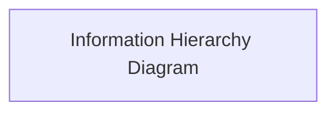
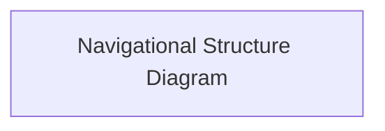
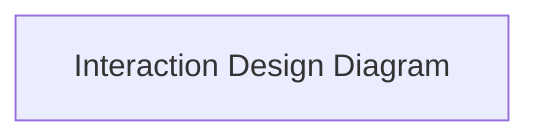
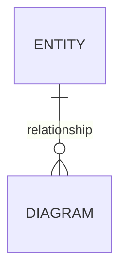

# Stash

Project overview/introduction.

[View the live site here.](live-link)

## Agile Delivery

### Agile Approach

### Scope & Prioritisation

### Backlog Management

### Development Workflow

### Continuous Quality Assurance

## UX

### Strategy

#### Purpose

#### User Needs

#### Business Requirements

### Scope

#### Mapping User Needs to Features

#### Defining MVP

### Structure

#### Information Architecture

#### Navigation Design

#### Interaction Design

### Skeleton

#### Wireframing

| Page | Mobile | Tablet | Desktop |
| --- | --- | --- | --- |

### Surface

Summary of the design philosophy and aims.

#### Colour

#### Typography

#### Shape & Space

#### Animation & Micro-Interactions

## Architecture

### Database & Model Design

#### Entity Relationships

#### Model Design

#### Role-Based Permissions

| Role | Permissions | Related Django Flag |
| --- | --- | --- |

### Application Structure & Data Boundaries

### Security & Authentication

### Server-Rendered Frontend & HTMX

## Features

| Feature | Appearance | User Value |
| --- | --- | --- |

### Future Features

## Quality Assurance

For readability, the detailed quality assurance documentation is maintained in [QA.md](documentation/QA.md), which can be found in the 'documentation' directory.

## Tools & Stack

### Tech Stack

### Development Tooling

### AI

## Deployment

### Render

### Local Development

## Acknowledgements
